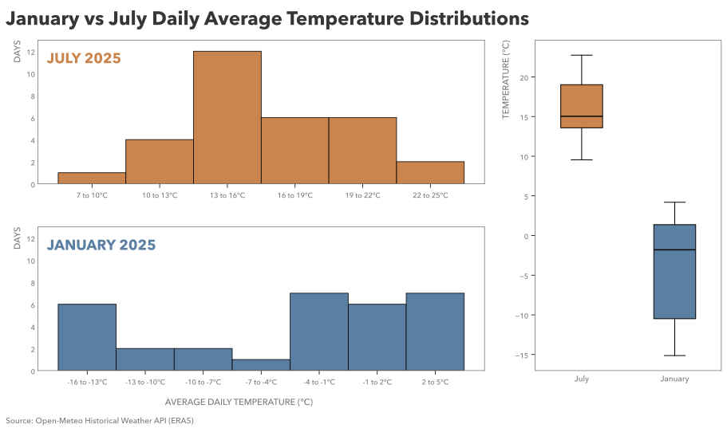

# Practice 11: January vs July Temperature Distribution, 2025

Calculate Calgary's daily average temperatures for January and July 2025 and compare the distributions of those daily observations.

## Problem

Compare the distribution of Calgary's daily average temperatures in January and July 2025.

## Parameters

- Data Source: Open-Meteo Historical Weather API (ERA5)
- Data Format: Parquet
- Source Grain: Hourly
- Source Timezone: UTC
- Analytical Timezone: America/Edmonton
- Input Fields: `time`, `temperature_2m`
- Output Grain: One row per Calgary-local calendar day in January or July 2025
- Tools: Python, pandas, Matplotlib, PyArrow
- Output: SVG multi-panel distribution comparison visualization
- Additional Practice:
  - Loading from Parquet with PyArrow
  - Converting UTC timestamps to Calgary-local analytical time
  - Hourly → daily aggregation for average temperature
  - Constructing equal-width histogram bins explicitly rather than relying on automatic bin placement
  - Labeling histogram bars by their underlying temperature intervals
  - Using boxplots to restore common-scale context for the two distributions
  - Coordinating separate histogram and boxplot views within a custom `GridSpec` layout

## Method

1. Open the Parquet dataset using PyArrow Dataset.
2. Selectively load only `time` and `temperature_2m` and convert the resulting Arrow table to pandas.
3. Convert the UTC timestamps to `America/Edmonton`.
4. Inspect the hourly table for structure, missingness, duplication, temporal sanity, and temperature plausibility.
5. Filter the data to January and July 2025.
6. Aggregate the hourly observations to one average temperature per calendar day.
7. Visualize the distributions using:
    - separate July and January histograms with explicit 3°C temperature intervals and a shared frequency scale;
    - independent histogram temperature ranges to preserve useful resolution within each month's distribution;
    - a common-scale boxplot panel to compare the location, spread, and extremes of the two distributions directly.
11. Save the completed figure as SVG.

## Output

#### Visualization



The left side of the figure shows the July and January daily average temperature distributions separately using equal-width 3°C histogram bins. Each histogram retains a temperature range suited to its own observations while using the same bin scale, allowing the internal shape of each distribution to remain visible without implying that the two histogram x-axes are directly aligned.

The histogram tick labels identify the actual temperature interval represented by each bar rather than using approximate bin-center labels.

The boxplots on the right provide the complementary common-scale comparison. January and July are placed on the same temperature axis so their relative location, spread, quartiles, medians, whiskers, and any outlying observations can be interpreted directly.

Together, the histogram and boxplot views preserve the individual daily observations as distributions while showing both within-month shape and between-month temperature context.

## Reproduction

```bash
uv sync
uv run python prepare_data.py
```

Then run `analysis.ipynb`.

## Data & Attribution

Open-Meteo ERA5 data, licensed under CC BY 4.0. Contains modified Copernicus Climate Change Service information (2026).

Neither the European Commission nor ECMWF is responsible for any use that may be made of the Copernicus information or data contained in this project.
