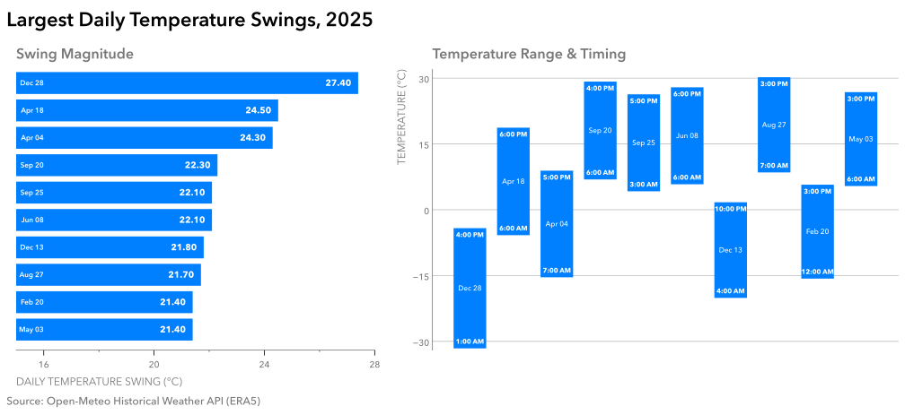

# Practice 10: Largest Daily Temperature Swings, 2025

Identify and visualize the 10 Calgary calendar days in 2025 with the largest difference between daily maximum and minimum temperature.

## Problem

Identify and visualize the 10 days in 2025 with the largest difference between maximum and minimum temperature.

## Parameters

- Data Source: Open-Meteo Historical Weather API (ERA5)
- Data Format: JSON
- Source Grain: Hourly
- Source Timezone: UTC
- Analytical Timezone: America/Edmonton
- Input Fields: `time`, `temperature_2m`
- Intermediate Grain: One row per Calgary-local calendar day
- Output Grain: One ranked row per day for the 10 largest daily temperature swings
- Tools: Python, pandas, Matplotlib, Python `json`
- Output: SVG two-panel visualization
- Additional Practice:
  - Loading and inspecting from JSON 
  - Converting from UTC to Calgary-local analytical time
  - Hourly → daily aggregation for minimum, maximum, and daily temperature swing
  - Recovering the timing of daily min and max temperatures with `idxmin()` / `idxmax()` and `map`
  - Ranking and selecting the top 10 daily swings with `nlargest()`
  - Building a ranked horizontal-bar view for local magnitude comparison
  - Building floating low-to-high interval bars to preserve minimum/maximum temperature context
  - Coordinating two complementary views of the same observations in a single figure
  - Using direct in-mark labels for dates, swing values, and minimum/maximum timing
  - Applying panel-specific scales, axes, spines, and gridlines based on each view's encoding
  - Using shared color and typography to visually link both panels

## Method

1. Load the .JSON data file using Python's `json` module.
2. Normalize the `hourly` subsection into a pandas DataFrame containing `time` and `temperature_2m`.
3. Convert the UTC timestamps to `America/Edmonton`.
4. Inspect the resulting hourly table for metadata, structure, missingness, duplication, and temporal sanity.
5. Filter observations to year 2025 and derive the local calendar date.
6. Aggregate the hourly observations to daily minimum and maximum temperatures.
7. Calculate each day's temperature swing as the daily maximum minus the daily minimum.
8. Retain the source-row indexes of each day's minimum and maximum temperatures and use them to recover the corresponding hours.
9. Select the 10 largest daily temperature swings with `nlargest()` and assign display ranks from 1 through 10.
10. Visualize the result in two coordinated views:
   - a ranked horizontal-bar view emphasizing differences in swing magnitude among the 10 selected days;
   - a floating temperature-range view positioning each day's minimum-to-maximum interval on an absolute temperature scale and showing when each extreme occurred.
11. Use direct labels inside the marks to identify dates, swing magnitudes, and minimum/maximum hours, while keeping axes and other structural elements visually subordinate.
12. Compose the two views into one figure with separate subplot titles, panel-specific axis treatment, and a shared visual language.
13. Save the completed figure as SVG.

## Output

#### Visualization



The left panel ranks the 10 largest daily temperature swings in 2025 and emphasizes the differences in swing magnitude within this selected top-10 set. The right panel provides complementary temperature context by placing each same-day interval between its daily minimum and maximum on an absolute temperature scale and directly labeling the hours at which those extremes first occurred.

The two panels use the same saturated blue to identify the same underlying observations while retaining different axis structures suited to their respective encodings. Dates and quantitative details are labeled directly within the marks, while gray axes, gridlines, and other structural elements remain visually subordinate.

The largest swing occurred on December 28, with a 27.4°C difference between a minimum of -31.6°C at 1:00 AM and a maximum of -4.2°C at 4:00 PM.

## Reproduction

```bash
uv sync
uv run python prepare_data.py
```

Then run `analysis.ipynb`.

## Data & Attribution

Open-Meteo ERA5 data, licensed under CC BY 4.0. Contains modified Copernicus Climate Change Service information (2026).

Neither the European Commission nor ECMWF is responsible for any use that may be made of the Copernicus information or data contained in this project.
