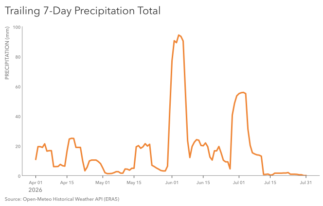

# Practice 12: Trailing 7-Day Precipitation Total, Spring–Summer 2026

Calculate and visualize Calgary's trailing 7-day precipitation total from April through July 2026.

## Problem

Show Calgary's trailing 7-day precipitation total from April through July 2026.

## Parameters

- Data Source: Open-Meteo Historical Weather API (ERA5)
- Data Format: CSV
- Source Grain: Hourly
- Source Timezone: UTC
- Analytical Timezone: America/Edmonton
- Input Fields: `time`, `precipitation`
- Intermediate Grain: One row per Calgary-local calendar day
- Output Grain: One row per Calgary-local calendar day from April through July 2026
- Tools: Python, pandas, Matplotlib
- Output: SVG time-series line visualization
- Additional Practice:
  - Early analytical-scope filtering
  - Hourly → daily aggregation for total precipitation
  - Trailing-window calculation with `rolling()`
  - Preserving daily and rolling precipitation values in the analytical table
  - Calendar-aware date-axis handling with `matplotlib.dates`
  - Semi-monthly tick placement using the 1st and 15th of each month
  - Explicit tick handling to add July 31 while removing the unwanted August 1 tick

## Method

1. Load `time` and `precipitation` from the CSV source and parse `time` as datetime.
2. Convert the UTC timestamps to `America/Edmonton`.
3. Inspect the hourly data for structure, missingness, duplication, temporal sanity, and precipitation plausibility.
4. Additionallly inspect positive precipitation observations separately after the overall distribution is found to be heavily concentrated at zero.
5. Retain the additional six calendar days before April 1 required to calculate the first complete trailing 7-day value.
6. Aggregate hourly precipitation to daily precipitation totals.
7. Calculate the trailing 7-day precipitation total from the daily series using `rolling(7)`.
8. Visualize the trailing 7-day precipitation total as a continuous time-series line.
9. Format the date axis using semi-monthly calendar ticks and explicitly include July 31 as the final displayed date.
10. Save the completed figure as SVG.

## Output

#### Visualization



The visualization shows Calgary's trailing 7-day precipitation total across April through July 2026. Each point in the line represents the total precipitation accumulated over that calendar day and the preceding six days, allowing short-term wet and dry periods to be read as a continuous temporal progression rather than as isolated daily totals.

The date axis uses the 1st and 15th of each month as regular calendar reference points and explicitly includes July 31 as the final displayed date. The year is identified separately from the recurring month-day labels to keep the temporal axis compact.

The series shows several distinct periods of accumulated precipitation, including the largest rolling total during June, followed by a prolonged decline into comparatively dry conditions during July.

## Reproduction

```bash
uv sync
uv run python prepare_data.py
```

Then run `analysis.ipynb`.

## Data & Attribution

Open-Meteo ERA5 data, licensed under CC BY 4.0. Contains modified Copernicus Climate Change Service information (2026).

Neither the European Commission nor ECMWF is responsible for any use that may be made of the Copernicus information or data contained in this project.
