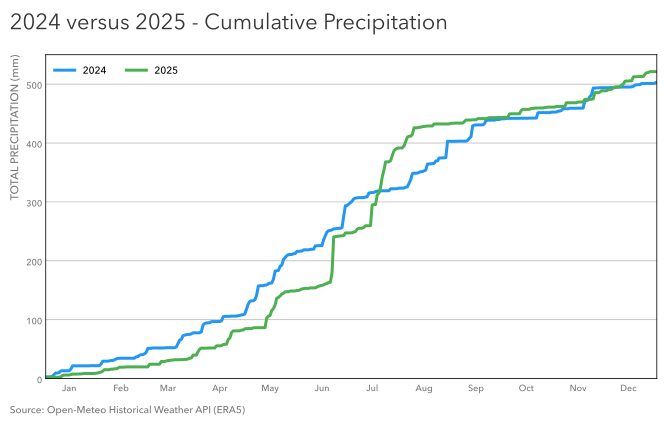

# Practice 13: Cumulative Precipitation, 2024 vs 2025

Compare how Calgary's total precipitation accumulated through the calendar year in 2024 and 2025.

## Problem

Compare Calgary's cumulative precipitation through the calendar year for 2024 and 2025.

## Parameters

- Data Source: Open-Meteo Historical Weather API (ERA5)
- Data Interface: PostgreSQL (SQL)
- Source Grain: Hourly
- Stored Timestamp Semantics: UTC-backed `TIMESTAMPTZ`
- Analytical Timezone: America/Edmonton
- Input Fields: `time`, `precipitation`
- Intermediate Grain: One row per Calgary-local calendar day for each year
- Output Grain: One row per aligned calendar month-day across 2024 and 2025, with cumulative precipitation for each year
- Tools: Python, pandas, Matplotlib, PostgreSQL, psycopg, SQLAlchemy, python-dotenv
- Output: SVG multi-line time-series visualization
- Additional Practice:
  - Loading from PostgreSQL using SQLAlchemy `URL` and `create_engine()` with `pd.read_sql_query()`
  - Using `.env` and `.env.example` with `load_dotenv()` for local database configuration
  - Deriving Calgary-local calendar dates from `TIMESTAMPTZ` in SQL
  - Hourly → daily precipitation aggregation in SQL
  - Aligning two calendar years by month-day while handling the 2024 leap day
  - Calculating cumulative precipitation with SQL window functions
  - Building multiple comparable time-series lines on a shared scale

## Method

1. Connect to PostgreSQL using `.env`-based configuration and a SQLAlchemy engine.
2. Query the hourly practice table for Calgary-local calendar years 2024 and 2025.
3. Convert each timestamp to `America/Edmonton` calendar time and aggregate hourly precipitation to daily totals separately for each year.
4. Align the two daily series by calendar month-day using a `FULL OUTER JOIN`, preserving February 29 from leap-year 2024.
5. Calculate cumulative precipitation for each year using ordered SQL window sums.
6. Load the aligned cumulative result into pandas.
7. Inspect the resulting table for structure, missingness, duplicate dates, ordering, cumulative-value ranges, and leap-day behavior.
8. Visualize 2024 and 2025 as comparable cumulative-precipitation lines on a common scale.
9. Save the completed figure as SVG.

## Output

#### Visualization



The figure compares how precipitation accumulated through the calendar year in 2024 and 2025 using the same calendar and precipitation scales.

2024 experienced a more gradual accumulation of precipitation, whereas 2025 had a much more 'jumpy' and seasonal accumulation and finished the year higher after a late period.

By the end of the year, cumulative precipitation reached approximately **503.5 mm in 2024** and **521.3 mm in 2025**, a difference of about **17.8 mm**.

The visualization intentionally retains daily cumulative observations. Flat sections represent periods with little or no new precipitation, while sharper increases identify periods when precipitation accumulated rapidly.

## Notes

Revisit to possibly consider smoothing for a cleaner visual experience and/or possibly a pareto chart trial.

## Reproduction

```bash
uv sync
uv run python prepare_data.py
```

Then run `analysis.ipynb`.

## Data & Attribution

Open-Meteo ERA5 data, licensed under CC BY 4.0. Contains modified Copernicus Climate Change Service information (2026).

Neither the European Commission nor ECMWF is responsible for any use that may be made of the Copernicus information or data contained in this project.
