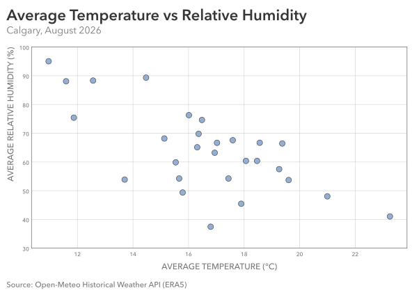
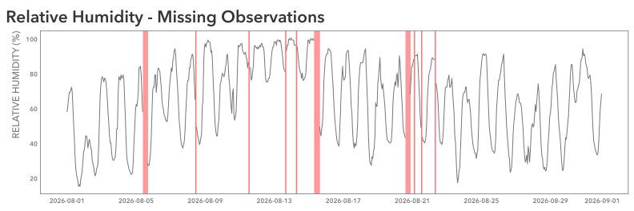

# Practice 14: Temperature vs Relative Humidity, August 2026

Investigate the relationship between daily average temperature and relative humidity in Calgary during August 2026.

## Problem

Show the relationship between daily average temperature and daily average relative humidity in Calgary during August 2026.

## Parameters

### Data & Analysis
- Data Source: Open-Meteo Historical Weather API (ERA5)
- Data Format: CSV
- Source Grain: Hourly
- Source Timezone: UTC
- Analytical Timezone: America/Edmonton
- Input Fields: `time`, `temperature_2m`, `relative_humidity_2m`
- Output Grain: One row per Calgary-local calendar day in August 2026 with at least 22 of 24 valid hourly humidity observations, with average temperature and average humidity for each day
- Tools: Python, pandas, Matplotlib
- Primary Output: SVG scatterplot visualization

### Starting Data Condition
- Data Condition: Missing Values (scattered + grouped)
- Affected Fields: `relative_humidity_2m`

### Additional Practice:
- Missing Values diagnosis with resulting additional inspections and cleaning
- Diagnostic Visualization for missing intervals
- Cleaning by completeness-based filtering
- Outlining analytical implications
- Daily aggregation of paired quantitative variables
- Scatterplot visualization

## Method

1. Load `time`, `temperature_2m`, and `relative_humidity_2m` from the CSV source, parsing time as a UTC datetime.
2. Convert timestamps to America/Edmonton and filter to August 2026.
3. Inspect the hourly data for structure, missingness, duplicates, temporal sanity, and value sanity.
4. Investigate missing values through column-level counts and percentages. Identify consecutive missing-humidity intervals, their durations, and their temporal distribution.
5. Visualize the missingness, highlighting isolated missing readings and consecutive missing intervals. Save the diagnostic figure as outputs/dirty.svg.
6. Apply the cleaning rule: retain only calendar days with at least 22 valid hourly humidity observations.
7. Aggregate the retained hourly observations into daily average temperature and daily average relative humidity.
8. Visualize the relationship between daily average temperature and daily average relative humidity as a scatterplot.
9. Save the completed analytical figure as SVG.

## Output

#### Visualization



The visualization shows a generally negative association between daily average temperature and daily average relative humidity in Calgary during August 2026. Warmer days tend to have lower relative humidity, although considerable variation exists among days with similar average temperatures.

Each point represents one eligible calendar day. The dispersion indicates that daily average temperature alone does not fully describe variation in relative humidity. The visualization represents an observed association rather than a causal relationship.

The analysis is restricted to days meeting the minimum humidity-completeness criterion.

## Data Quality & Handling



The starting dataset was deliberately corrupted with missing relative-humidity measurements using a reproducible pattern.

### Observed Condition:
  - Impacted Columns: `relative_humidity_2m`
  - Missing Readings: 26 of 744 (3.49%)
  - Affected Days: 9
  - Largest Contiguous Missing Interval: 7 hours
  - Distribution: A mix of isolated missing values and longer periods of missing values

### Analytical Handling:

Days with fewer than 22 valid hourly humidity observations were excluded from the analysis. No missing humidity measurements were imputed.

  - Excluded Days: 3
  - Retained Days: 28

The 22/24 criterion permits a limited amount of incomplete measurement while excluding days with more substantial missingness.

For retained days, average humidity is calculated from the available 22–24 hourly observations, while average temperature uses all 24 hourly observations.

Excluding incomplete days also changes the analytical population. The final relationship describes eligible August 2026 days rather than necessarily representing the entire month. If excluded days differ systematically in their weather conditions, their omission may affect the observed association.

The completeness criterion is a pragmatic analytical decision, not a guarantee that the retained daily averages are unbiased.

## Reproduction

```bash
uv sync
uv run python prepare_data.py
uv run python dirty_data.py
```

Then run `analysis.ipynb`.

## Data & Attribution

Open-Meteo ERA5 data, licensed under CC BY 4.0. Contains modified Copernicus Climate Change Service information (2026).

Neither the European Commission nor ECMWF is responsible for any use that may be made of the Copernicus information or data contained in this project.
