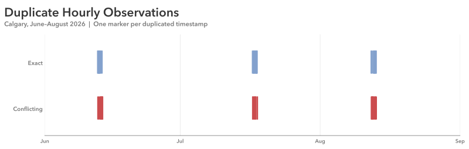

# Practice 15: Hot and Dry Daytime Hours, Summer 2026

Investigate how often Calgary's daytime hours were both hot and dry during summer 2026, while diagnosing and handling deliberately duplicated hourly observations.

## Problem

For each month from June through August 2026, show the percentage of Calgary daytime hours that were both above 25°C and below 40% relative humidity.

## Parameters

### Data & Analysis
- Data Source: Open-Meteo Historical Weather API (ERA5)
- Data Format: Parquet
- Source Grain: Hourly
- Source Timezone: UTC
- Analytical Timezone: `America/Edmonton`
- Input Fields: `time`, `temperature_2m`, `relative_humidity_2m`
- Hot-and-Dry Definition: Temperature strictly above 25°C and relative humidity strictly below 40%
- Output Grain: One row per month in Summer 2026 of unique, unambiguous hourly observations, with daytime-hour counts, weather-condition counts, and corresponding percentages
- Tools: Python, pandas, Matplotlib, PyArrow
- Primary Output: SVG monthly hot-and-dry percentage dot plot

### Starting Data Condition
- Data Condition: Duplicate hourly observations (exact and conflicting)
- Affected Fields: `temperature_2m`

### Additional Practice:
- Selective Parquet loading with PyArrow and local-time filtering
- Duplicate Values diagnosis with resulting additional inspections and cleaning
- Diagnostic Visualization of exact versus conflicting duplicates
- Cleaning through exact deduplication and exclusion of unresolved conflicting timestamps
- Explicit daytime, event, and denominator definitions
- Visualization selection, supporting analytical context, and interpretation

## Method

1. Load `time`, `temperature_2m`, and `relative_humidity_2m` from the Parquet dataset with PyArrow, parsing time as a UTC datetime.
2. Convert timestamps to America/Edmonton and filter to August 2026.
3. Inspect the hourly data for structure, missingness, duplicates, temporal sanity, and value sanity.
4. Investigate duplicate values. Quantify exact duplicate rows and repeated timestamps. Examine all records involved in repeated timestamps to distinguish identical copies from disagreeing measurements.
5. Visualize conflicting timestamps and summarize duplicated and conflicting daytime hours by month. Save the diagnostic figure as outputs/dirty.svg.
6. Apply the cleaning rule: Remove redundant exact duplicate records. Exclude timestamps with conflicting observations.
7. Define daytime as hours 8–19 inclusive, and a hot-and-dry hour as one satisfying both strict temperature and humidity thresholds.
8. Filter to the eligible daytime hours, then classify each into exactly one of four conditions: hot and dry, hot only, dry only, or neither.
9. Aggregate the hourly classifications into monthly counts and percentages. Verify that the four categories reconcile to the eligible hours and that percentages sum to 100%.
10. Visualize the monthly hot-and-dry percentages using a directly labeled dot plot.
11. Save the completed analytical figure as SVG.

## Output

#### Visualization

![Monthly share of hot-and-dry daytime hours, Calgary, summer 2026]](outputs/dotplot_hot-dry-daytime-hours-summer-2026.svg)

The share of **eligible daytime hours** that were both above 25°C and below 40% relative humidity differed considerably between the three months: **0.3% in June, 34.2% in July, and 13.0% in August**. July had the highest qualifying share, while June had almost none.

Each plotted point represents one monthly percentage, calculated using the retained observations after cleaning. These are percentages of *eligible observed daytime hours*, not necessarily every scheduled daytime hour.

### Supporting Classification

The expanded transformation retained the following mutually exclusive breakdown of eligible daytime observations:

| Month | Eligible hours | Hot and dry | Hot only | Dry only | Neither |
|---|---:|---:|---:|---:|---:|
| June | 350 | 1 (0.3%) | 0 (0.0%) | 72 (20.6%) | 277 (79.1%) |
| July | 366 | 125 (34.2%) | 29 (7.9%) | 13 (3.6%) | 199 (54.4%) |
| August | 361 | 47 (13.0%) | 15 (4.2%) | 72 (19.9%) | 227 (62.9%) |

###
This provides context that the dot plot alone cannot: **June's near-zero hot-and-dry share was primarily constrained by the temperature threshold**, rather than a complete absence of dry conditions. June had 73 dry hours (20.9% of eligible hours), but only one hour above 25°C. July had 154 hot hours (42.1%) and 138 dry hours (37.7%), with substantial overlap. August still had 119 dry hours (33.0%), but only 62 hot hours (17.2%), helping explain its smaller hot-and-dry share relative to July.

These comparisons describe how the defined conditions occurred together; they do not establish causal explanations for the weather.

### Analytical & Visualization Development

The original transformation calculated only the monthly percentage of hours satisfying both thresholds. Its dot plot answered the stated question clearly, but raised a further interpretive question: **what conditions accounted for the remaining daytime hours?**

To investigate, the transformation was expanded to define separate `hot` and `dry` Boolean conditions and partition eligible hours into four exhaustive, nonoverlapping categories. Their monthly counts and percentages were retained in `output_df`, with reconciliation checks to confirm the partition.

A **100% stacked composition chart** and a presentation sequence that faded nonfocus categories were considered, as was a grouped comparison of the individual hot and dry thresholds with their overlap. The observed results changed the design judgment: the large **neither** category would dominate much of a stacked view, while June's 0.3% hot-and-dry segment would be difficult to see. More categories or graphical emphasis would not necessarily improve communication of the original monthly comparison.

The **directly labeled dot plot remained the primary output**. The four-way classification is retained as supporting analysis, allowing the presenter or reader to explain *why the reported proportions differ in terms of the defined thresholds* without requiring every detail to appear in the chart. The alternative chart treatments were considered rather than adopted as final outputs.

## Data Quality & Handling



The Parquet dataset was deliberately modified with reproducible, grouped duplication. The diagnostic separates **exact** and **conflicting** duplicated timestamps across the summer.

### Observed Condition:
  - Impacted Columns: `temperature_2m`
  - Exact Duplicate Rows: 43 (1.88%)
  - Conflicting Duplicate Rows: 42 (1.83%)

### Analytical Handling:

Exact duplicate copies were removed, leaving one instance of each identical record. For conflicting timestamps, neither measurement was assumed authoritative; **both records were excluded** rather than arbitrarily retaining the first or last version.

- Exact Duplicate Copies Removed: 43
- Conflicting Timestamps Excluded: 42, including 27 daytime hours
- Duplicate Timestamps Remaining After Cleaning: 0

Under the 08:00–19:59 definition, June–August contains 1,104 scheduled daytime hours. After excluding 10 conflicting daytime hours in June, 6 in July, and 11 in August, **1,077 eligible daytime hours** remained (350, 366, and 361 respectively). The 15 excluded conflicting nighttime hours do not affect the monthly daytime denominators.

This treatment avoids assigning an unsupported measurement to a disputed hour, but it also excludes potentially valid observations. If conflicting hours were systematically more or less likely to satisfy the event conditions, the reported percentages could differ from those for all scheduled daytime hours. The analysis therefore describes the retained, unambiguous hourly population.

## Reproduction

```bash
uv sync
uv run python prepare_data.py
uv run python dirty_data.py
```

Then run `analysis.ipynb`.

## Data & Attribution

Open-Meteo ERA5 data, licensed under CC BY 4.0. Contains modified Copernicus Climate Change Service information (2026).

Neither the European Commission nor ECMWF is responsible for any use that may be made of the Copernicus information or data contained in this project.
