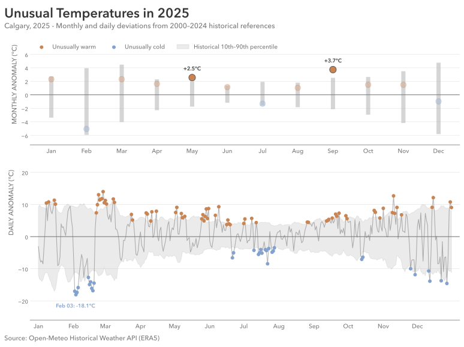

# Practice 16: Historical Temperature Anomalies, 2025

Investigate unusually warm and cold months and days in Calgary during 2025 relative to historical temperatures from 2000–2024.

## Problem

Compare Calgary's monthly and daily average temperatures in 2025 against historical references from 2000–2024, identifying unusually warm and cold periods.

## Parameters

### Data & Analysis
- Data Source: Open-Meteo Historical Weather API (ERA5)
- Data Format: JSON
- Source Grain: Hourly
- Source Timezone: UTC
- Analytical Timezone: `America/Edmonton`
- Input Fields: `time`, `temperature_2m`
- Output Grain: Monthly and daily temperature anomalies for 2025, with historical reference intervals and classifications
- Tools: Python, pandas, Matplotlib
- Primary Output: SVG two-panel visualization

### Starting Data Condition
- Data Condition: Invalid Values (scattered)
- Affected Fields: `temperature_2m`

### Additional Practice:
- JSON loading and Unix timestamp conversion
- Invalid value diagnosis and cleaning
- Historical reference construction through multi-stage aggregation
- Monthly and daily calendar alignment
- Percentile-based anomaly classification
- One-to-one merging and validation
- Multi-panel visualization of deviations and historical intervals

## Method

1. Load `time` and `temperature_2m` from the JSON source, parsing Unix timestamps as UTC datetimes.
2. Convert timestamps to America/Edmonton and filter to 2000–2025.
3. Inspect the hourly data for structure, missingness, duplicates, temporal sanity, and value sanity.
4. Investigate implausible temperatures through counts, percentages, affected observations, and their distribution across years.
5. Replace out-of-bounds temperature measurements with missing values while preserving the hourly records.
6. Aggregate hourly temperatures into year-month averages. Construct historical monthly averages and 10th–90th percentile intervals from the 2000–2024 observations.
7. Compare 2025 monthly averages against their historical references, calculating temperature deviations and identifying months outside their historical intervals.
8. Aggregate temperatures into daily averages. Construct daily historical references using five-day calendar windows across 2000–2024, excluding February 29 and accounting for year boundaries.
9. Compare 2025 daily averages against their corresponding historical references, calculating deviations and identifying unusually warm and cold days.
10. Validate the resulting monthly and daily comparisons, then visualize both using historical reference intervals and highlighted anomalous observations.
11. Save the completed analytical figure as SVG.

## Output

#### Visualization



The visualization identifies two unusually warm months, May (+2.55°C) and September (+3.73°C), and no unusually cold months under the selected 80 percentile range from the 10th to 90th percentile definition.

At daily grain, 69 unusually warm days and 32 unusually cold days were identified. February contained several substantial cold departures, including February 3 at −18.06°C relative to its historical daily reference. Despite this, February's monthly average remained within its historical reference interval.

The analysis initially compared monthly averages with their historical means. The transformation was expanded to include historical percentile thresholds, comparing ordinary deviations from historically/notably unusual observations. The final visualization uses two panels to show both monthly conditions and shorter daily departures, with stronger colors highlighting observations outside their reference intervals.

## Data Quality & Handling

The starting JSON dataset was deliberately corrupted with implausible temperature measurements using a reproducible pattern.

### Observed Condition:
- Impacted Columns: `temperature_2m`
- Invalid Readings: 64 (0.03%)
- Observed Invalid Values: −100°C and +95°C
- Affected Year: 2025
- Distribution: Scattered invalid temperature measurements

### Analytical Handling:

Temperature measurements outside −45°C to +45°C were treated as invalid and replaced with `NaN`. 

No hourly records were removed, and no replacement temperatures were imputed. Monthly and daily averages were calculated from the remaining valid measurements.

## Reproduction

```bash
uv sync
uv run python prepare_data.py
uv run python dirty_data.py
```

Then run `analysis.ipynb`.

## Data & Attribution

Open-Meteo ERA5 data, licensed under CC BY 4.0. Contains modified Copernicus Climate Change Service information (2026).

Neither the European Commission nor ECMWF is responsible for any use that may be made of the Copernicus information or data contained in this project.
