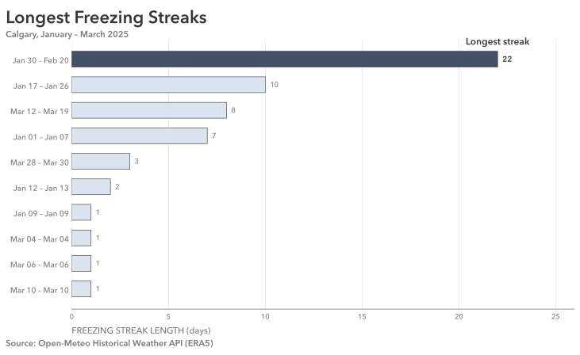

# Practice 17: Longest Freezing Streak, Winter 2025

Investigate Calgary's longest consecutive freezing-day streaks during January–March 2025, while assessing how missing hourly observations affect the analytical result. 

## Problem

Find Calgary's longest consecutive run of days with an average temperature below 0°C during January through March 2025, and visualize where it occurred.

## Parameters

### Data & Analysis
- Data Source: Open-Meteo Historical Weather API (ERA5)
- Data Format: SQL (PostgreSQL)
- Source Grain: Hourly
- Source Timezone: UTC
- Analytical Timezone: `America/Edmonton`
- Input Fields: `time`, `temperature_2m`
- Output Grain: One row per consecutive freezing-day streak, containing its start and end dates, duration in days, and missing-data counts
- Tools: Python, pandas, Matplotlib, PostgreSQL, psycopg, SQLAlchemy, python-dotenv
- Primary Output: SVG horizontal bar visualization

### Starting Data Condition
- Data Condition: Missing Records (grouped and scattered)
- Affected Data: Hourly temperature observations in January–March 2025

### Additional Practice
- Temporal gap detection and daylight-saving-aware time handling
- Expected hourly timeline reconstruction and daily resampling
- Consecutive-condition identification and streak aggregation
- Missing-data impact and classification sensitivity analysis
- Historical conditional probability estimation
- Ranked visualization with emphasis on the leading result

## Method

1. Load hourly temperature observations for January–March 2025 from PostgreSQL, converting timestamps from UTC to `America/Edmonton`.
2. Inspect structure, missingness, duplicates, temporal continuity, and temperature values. Investigate unexpected timestamp intervals to establish the extent and distribution of missing records.
3. Defer missing-temperature estimation until its potential impact on the analytical result can be established.
4. Reconstruct the expected hourly timeline and aggregate observations into daily average temperatures and missing-hour counts.
5. Identify and rank all available freezing streaks, then calculate possible streaks by allowing days with missing observations to qualify as freezing.
6. Investigate missing intervals within the leading possible streak, including their duration and surrounding observed temperatures.
7. Evaluate incomplete days by calculating the average missing-hour temperature required to raise their full-day average to 0°C. Identify which classifications remain meaningfully uncertain.
8. Load and inspect January–February historical temperatures from 2020–2024. Calculate daily averages and identify three-day sequences where the first and third days were freezing.
9. Estimate the conditional frequency of a freezing middle day using historical cases, and examine variation across historical years.
10. Treat February 2 as freezing under the historical-evidence assumption, recalculate the longest streaks, and prepare the ranked results for visualization.
11. Visualize the ten longest estimated streaks using a horizontal bar chart, highlighting the leading streak.
12. Save the completed analytical figure as SVG.

## Output

#### Visualization



The analysis identifies an estimated **22-day freezing streak from January 30 through February 20, 2025**, substantially longer than the next-ranked streak of 10 days.

The initial available-data analysis identified an 18-day streak from February 3 through February 20. Allowing incomplete days to qualify as freezing revealed a possible 22-day streak, interrupted by a major hourly data outage covering February 1–3.

Sensitivity analysis established that the partially observed days within this interval would require implausibly high missing-hour temperatures to become nonfreezing. February 2, with all 24 observations absent, remained the principal uncertainty.

Historical analysis found that **162 of 174 three-day cases (93.1%)** with freezing days on both sides also had a freezing middle day. The conditional freezing rate exceeded 85% in each of the five historical years examined.

Based on this evidence, February 2 was assumed to be freezing, producing the estimated 22-day result. The historical percentage represents an empirical conditional frequency rather than a verified probability specific to February 2.

The final visualization ranks the longest freezing streaks, emphasizing the leading 22-day interval while retaining the remaining streaks for comparison.

## Data Quality & Handling

The starting PostgreSQL dataset was deliberately corrupted through reproducible deletion of hourly records.

### Observed Condition
- Missing Hourly Records: 86 of 2,159 expected (3.98%)
- Major Outages: 2, containing 38 and 39 missing hours
- Isolated Missing Hours: 9
- Affected Period: January–March 2025
- Other Quality Checks: No null measurements, duplicate timestamps, or non-monotonic timestamps in the surviving observations

### Analytical Handling

The expected hourly timeline was restored to represent missing observations explicitly. No missing hourly temperatures were interpolated or imputed.

The available and possible freezing streaks were calculated before determining whether estimation was necessary.

The leading possible streak contained 42 missing hourly observations across five dates. Classification sensitivity analysis indicated that February 1, 3, 4, and 6 could reasonably be treated as freezing without reconstructing their missing temperatures.

February 2 was entirely unobserved. Its freezing classification was inferred using historical January–February observations from 2020–2024, conditional on both neighboring days being freezing.

The historical estimate was examined across individual years. No separate out-of-sample model validation or comparison against the withheld complete 2025 observations was performed.

The final 22-day streak is therefore an estimated analytical result, contingent on the February 2 freezing assumption, rather than an entirely observed streak.

## Reproduction

Configure the local PostgreSQL connection through `.env`, using `.env.example` as a reference.

```bash
uv sync
uv run python prepare_data.py
uv run python dirty_data.py
```

Then run `analysis.ipynb`.

## Data & Attribution

Open-Meteo ERA5 data, licensed under CC BY 4.0. Contains modified Copernicus Climate Change Service information (2026).

Neither the European Commission nor ECMWF is responsible for any use that may be made of the Copernicus information or data contained in this project.
