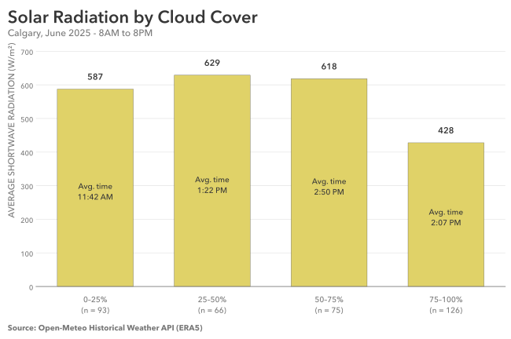

# Practice 18: Solar Radiation by Cloud-Cover Band, June 2025

Investigate how average shortwave solar radiation varies across cloud-cover categories in Calgary during June 2025. 

## Problem

During 8AM – 8PM in June 2025, compare Calgary's average shortwave radiation across defined cloud-cover ranges.

## Parameters

### Data & Analysis
- Data Source: Open-Meteo Historical Weather API (ERA5)
- Data Format: CSV
- Source Grain: Hourly
- Source Timezone: UTC
- Analytical Timezone: `America/Edmonton`
- Input Fields: `time`, `cloud_cover`, `shortwave_radiation`
- Output Grain: One row per cloud-cover band, containing average shortwave radiation, observation count, and mean observation hour
- Tools: Python, pandas, Matplotlib
- Primary Output: SVG vertical bar visualization

### Starting Data Condition
- Data Condition: Mixed numeric representations
- Affected Field: `cloud_cover`
- Representation Issue: Selected numeric observations stored with a percentage suffix

### Additional Practice
- Numeric representation inspection and normalization
- Numeric binning and category-boundary handling
- Bin coverage and exclusivity validation
- Category-based aggregation and magnitude comparison

## Method

1. Load `time`, `cloud_cover`, and `shortwave_radiation` from the CSV source, convert timestamps from UTC to `America/Edmonton`, and filter to June 2025.
2. Investigate the unexpected `object` dtype in `cloud_cover`, identifying observations containing nonnumeric representations.
3. Normalize percentage-suffixed cloud-cover values into numeric measurements and verify successful conversion.
4. Inspect the cleaned data for structure, missingness, duplicates, temporal continuity, and value sanity.
5. Filter to daytime observations from 8 AM inclusive to 8 PM exclusive.
6. Assign cloud-cover measurements to four categories: 0–25%, 25–50%, 50–75%, and 75–100%, using defined numerical boundaries.
7. Validate the category assignments and expected daytime observation count.
8. Aggregate observations by cloud-cover band, calculating average shortwave radiation and observation counts.
9. Investigate the unexpectedly lower radiation average in the 0–25% category by calculating the mean observation hour for each band.
10. Visualize average radiation across the four categories, including observation counts and mean observation times as supporting context.
11. Save the completed analytical figure as SVG.

## Output

#### Visualization



Average shortwave radiation was highest in the 25–50% cloud-cover band (628.74 W/m²), followed by 50–75% (618.17 W/m²) and 0–25% (587.44 W/m²). The 75–100% band had the lowest average radiation at 427.73 W/m².

The relationship was not strictly decreasing across cloud-cover categories. In particular, the clearest-sky category had a lower average radiation than both intermediate categories.

Further investigation showed that observations in the 0–25% category occurred earlier on average (11:42 AM) than those in the 25–50% (1:22 PM) and 50–75% (2:50 PM) categories. Differences in observation timing may contribute to the unexpected ordering, although mean observation time alone does not establish the explanation.

The final visualization compares the four average radiation values, with observation counts beneath each category and mean local observation times within the bars. These provide additional context without shifting attention away from the main comparison.

## Data Quality & Handling

The starting CSV dataset was deliberately corrupted with inconsistent numeric representations using a reproducible pattern.

### Observed Condition
- Impacted Column: `cloud_cover`
- Affected Records: 13 of 720 (1.81%)
- Representation Issue: Numeric percentage values containing a `%` suffix
- Affected Period: June 2025
- Distribution: Grouped and scattered affected observations

### Analytical Handling

Percentage-suffixed measurements were normalized by removing the suffix and converting the values to numeric types, preserving the original 0–100 percentage scale.

All 13 affected measurements were successfully recovered. No observations were removed or imputed.

Subsequent inspection confirmed no missing values, duplicate timestamps, temporal gaps, or out-of-range cloud-cover measurements within June 2025.

The daytime analytical population contained 360 hourly observations. All observations were successfully assigned to the four cloud-cover categories, with no unassigned values.

## Reproduction

```bash
uv sync
uv run python prepare_data.py
uv run python dirty_data.py
```

Then run `analysis.ipynb`.

## Data & Attribution

Open-Meteo ERA5 data, licensed under CC BY 4.0. Contains modified Copernicus Climate Change Service information (2026).

Neither the European Commission nor ECMWF is responsible for any use that may be made of the Copernicus information or data contained in this project.
