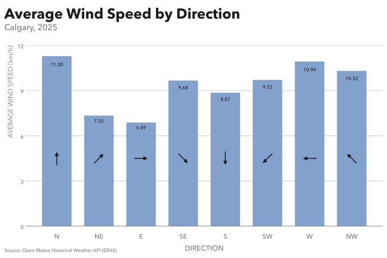

# Practice 19: Wind Speed by Direction, 2025

Investigate how Calgary's average hourly wind speed varies across eight compass-direction sectors during 2025.

## Problem

Group Calgary's 2025 hourly wind observations into eight compass-direction sectors and compare average wind speed across those sectors.

## Parameters

### Data & Analysis
- Data Source: Open-Meteo Historical Weather API (ERA5)
- Data Format: Random - JSON 
- Source Grain: Hourly
- Source Timezone: UTC
- Analytical Timezone: `America/Edmonton`
- Input Fields: `time`, `wind_speed_10m`, `wind_direction_10m`
- Output Grain: One row per compass-direction sector, containing average wind speed and observation count
- Tools: Python, pandas, Matplotlib
- Primary Output: SVG vertical bar visualization

### Starting Data Condition
- Data Condition: Random - Conflicting timestamp duplicates
- Affected Field: Random - `wind_direction_10m`
- Corruption Variant: Random - Conflicting
- Corruption Seed: `597400`
- Affected Timestamps: 247 of 8,760 (2.82%)
- Rows Involved: 494

### Additional Practice
- JSON loading and timezone-aware timestamp handling
- Duplicate timestamp and temporal-continuity investigation
- Analytical relevance assessment of conflicting observations
- Circular-variable interpretation and compass-sector construction
- Numerical binning and category-boundary handling
- Evidence-based duplicate resolution
- Sector-based aggregation and magnitude comparison
- Independent visualization design using Matplotlib

## Method

1. Load `time`, `wind_speed_10m`, and `wind_direction_10m` from the JSON source, interpret Unix timestamps as UTC, convert to `America/Edmonton`, and filter to the 2025 local calendar year.
2. Inspect the dataset for structure, missingness, exact duplicates, duplicate timestamps, temporal continuity, and value sanity.
3. Investigate the duplicate timestamps, identifying 247 affected hours represented by 494 rows.
4. Verify that all 8,760 expected hourly timestamps are present and investigate the multiplicity of duplicated timestamps.
5. Define eight 45° compass-direction sectors, accounting for the circular 0°/360° boundary and using lower-inclusive, upper-exclusive intervals.
6. Compare the wind-direction measurements within duplicated timestamps by assigning both observations to their respective compass sectors.
7. Verify that all duplicated observations have identical wind speeds, while identifying six timestamp pairs whose directions fall into different sectors.
8. Remove both observations for the six unresolved sector-conflicting timestamps. For the remaining 241 duplicated timestamps, retain one observation per hour because the wind speeds and sector assignments agree.
9. Verify that the cleaned dataset contains no duplicate timestamps.
10. Assign each retained hourly observation to a compass sector using the same binning function developed during inspection.
11. Aggregate observations by sector, calculating average wind speed and contributing observation count, and arrange the results in compass order.
12. Visualize average wind speed across the eight sectors using a vertical bar chart with numerical labels and compass-reference arrows.
13. Save the completed analytical figure as SVG.

## Output

#### Visualization



Average wind speed was highest for North winds (11.30 km/h), followed by West (10.94 km/h) and northwesterly winds (10.32 km/h). East winds had the lowest average speed (6.89 km/h), followed by NE winds (7.35 km/h). The difference between the highest and lowest sector averages was approximately 4.41 km/h.

Observation counts varied considerably across sectors. Westerly winds accounted for the largest number of retained hourly observations (2,205), while northeasterly winds accounted for the fewest (483).

The final visualization preserves compass ordering, with direct numerical labels and directional arrows providing visual context. The arrows indicate compass bearings rather than the direction of wind travel.

## Data Quality & Handling

The starting JSON dataset was deliberately corrupted with conflicting duplicate observations using a reproducible, seeded pattern.

### Observed Condition
- Impacted Column: `wind_direction_10m`
- Corruption Family: Duplicates
- Corruption Variant: Conflicting
- Starting Records: 9,007
- Unique Timestamps: 8,760
- Affected Timestamps: 247 (2.82% of expected hourly timestamps)
- Rows Involved: 494
- Excess Duplicate Rows: 247
- Affected Period: 2025

### Analytical Handling

Initial inspection found no missing values or exact duplicate rows, but identified repeated timestamps and unexpected hourly time differences. A separate temporal-coverage check confirmed that all 8,760 expected hourly timestamps were present. Each affected timestamp occurred exactly twice. Further investigation established that the duplicated observations had identical wind speeds but different wind-direction measurements.

The duplicated directions were compared using the eight compass-sector definitions:
- 241 duplicated timestamps had different numerical directions but identical sector assignments.
- 6 duplicated timestamps had conflicting sector assignments.

Because wind speeds were identical within every duplicated pair, the 241 same-sector disagreements did not affect the requested sector-level aggregation. One observation was retained for each of these timestamps. For the six cross-sector disagreements, the available data did not establish which sector assignment was correct. Both observations were therefore excluded for each affected timestamp rather than selecting an arbitrary direction.

In total, 253 rows were removed: 241 redundant duplicate rows and 12 rows belonging to the six excluded timestamps.

The final analytical population contained 8,754 hourly observations, with no remaining duplicate timestamps. All 8,754 retained observations were assigned to the eight compass sectors. The six excluded hours represent deliberate analytical exclusions rather than initially missing source timestamps.

## Reproduction

From the practice directory:

```bash
uv sync
uv run python prepare_data.py
uv run python dirty_data.py
```

Then run `analysis.ipynb`.

## Data & Attribution

Open-Meteo ERA5 data, licensed under CC BY 4.0. Contains modified Copernicus Climate Change Service information (2026).

Neither the European Commission nor ECMWF is responsible for any use that may be made of the Copernicus information or data contained in this project.
