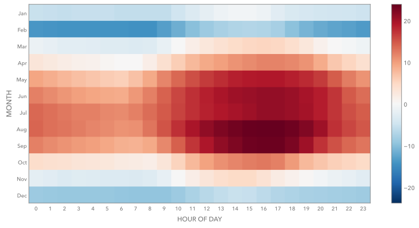

# Practice 20: Average Temperature by Month and Hour, 2025

Investigate how Calgary's average hourly temperature varies jointly by month and hour of day during 2025.

## Problem

Calculate average temperature for each month–hour combination in Calgary during 2025, and visualize in a heatmap.

## Parameters

### Data & Analysis
- Data Source: Open-Meteo Historical Weather API (ERA5)
- Data Format: CSV
- Source Grain: Hourly
- Source Timezone: UTC
- Analytical Timezone: `America/Edmonton`
- Input Fields: `time`, `temperature_2m`
- Output Grain: One average temperature per month–hour combination, pivoted as a 12 × 24 matrix 
- Tools: Python, pandas, Matplotlib
- Primary Output: SVG temperature heatmap

### Starting Data Condition
- Data Condition: Clean 

### Additional Practice
- Two-dimensional aggregation and long-to-wide reshaping with `pivot()`
- Structural validation of a complete 12 × 24 analytical matrix
- Independent heatmap design and color-scale interpretation using Matplotlib

## Method

1. Load `time` and `temperature_2m` from the CSV source, convert timestamps to `America/Edmonton`, and filter to the 2025 local calendar year.
2. Inspect the data's shape, types, missingness, duplicate rows, duplicate timestamps, chronological order, hourly continuity, and temperature distribution.
3. Confirm that the retained dataset contains 8,760 hourly observations, with no missing values, duplicate records or timestamps, non-monotonic timestamps, or unexpected hourly intervals.
4. Make no cleaning changes because inspection identifies no issues requiring correction.
5. Derive numeric month and local hour of day, then group by both dimensions to calculate mean `temperature_2m` for each combination.
6. Validate that all 288 month–hour combinations are represented and that none of the calculated averages is missing.
7. Pivot the grouped results into a 12-row × 24-column matrix, with months as rows and hours as columns.
8. Render the matrix using `imshow()` with a diverging, zero-centered temperature color scale; label the month and hour axes and include a colorbar.
9. Save the completed heatmap as SVG.

## Output

#### Visualization



The heatmap shows two overlapping patterns: colder winter and warmer summer months, together with a recurring daily cycle of cooler early-morning temperatures and warmer afternoon temperatures. The intraday contrast is especially visible from spring through early autumn.

In the grouped results, August at 16:00 has an average temperature of approximately **23.84°C**, while February at 07:00 and 08:00 averages approximately **−14.35°C**. These are averages within month–hour groups, not the highest or lowest individual hourly temperatures observed during the year.

The diverging color scale is symmetric around **0°C**. Each heatmap cell represents the mean of the observations associated with that month and local hour.

## Data Quality & Handling

The starting CSV dataset was generated with no dirty condition: no synthetic data-quality defects were introduced.

## Reproduction

From the practice directory:

```bash
uv sync
uv run python prepare_data.py
uv run python dirty_data.py
```

Then run `analysis.ipynb`.

## Data & Attribution

Open-Meteo ERA5 data, licensed under CC BY 4.0. Contains modified Copernicus Climate Change Service information (2026).

Neither the European Commission nor ECMWF is responsible for any use that may be made of the Copernicus information or data contained in this project.
