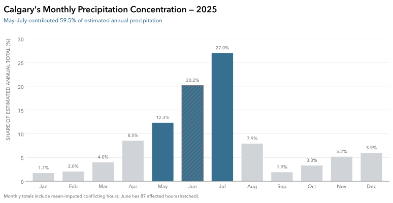

# Practice 21: Concentration of Annual Precipitation, 2025

Investigate how Calgary's 2025 precipitation was distributed across months and how much was concentrated in a small part of the year.

## Problem

What share of annual precipitation fell in each month, and how concentrated was the total across the twelve months?

## Parameters

### Data & Analysis
- Data Source: Open-Meteo Historical Weather API (ERA5)
- Data Format: Random — Parquet
- Source Grain: Hourly; UTC timestamps
- Analytical Timezone: `America/Edmonton`
- Input Fields: `time`, `precipitation`
- Output Grain: One row per month with estimated total and annual share
- Tools: Python, pandas, Matplotlib, PyArrow
- Primary Output: SVG monthly precipitation-share bar chart

### Starting Data Condition
- Data Condition: Random — Conflicting timestamp duplicates
- Affected Field: `precipitation`
- Corruption Seed: `006050`

### Additional Practice
- Parquet loading and timezone-aware inspection
- Diagnosis of conflicting and temporally clustered duplicates
- Estimation under unresolved measurements
- Part-to-whole analysis and uncertainty-aware visualization

## Method

1. Load the required Parquet fields, convert timestamps to Calgary local time, and filter to 2025.
2. Inspect missingness, duplicate records and timestamps, temporal continuity, and precipitation values.
3. Investigate conflicting timestamp pairs and their monthly distribution.
4. Exclude both records at unresolved timestamps, restore the hourly index, and impute the resulting gaps using each month's mean of uncontested observations.
5. Aggregate estimated precipitation by month; calculate each month's percentage of the estimated annual total and validate that the twelve shares sum to 100%.
6. Plot monthly shares in calendar order, emphasizing May–July and marking June's greater uncertainty. 
7. Save the completed heatmap as SVG.

## Output

### Visualization



Estimated annual precipitation was **529.8 mm**. May–July contributed **59.5%** of the estimated total: May **12.3%**, June **20.2%**, and July **27.0%**. July had the largest estimated monthly share under the chosen imputation method.

These figures depend on how the conflicting hours were treated, particularly in June; they should not be interpreted as verified original totals.

## Data Quality & Handling

The starting dataset contained **8,938 rows** covering **8,760 unique hours**. There were **178 conflicting timestamps** (2.03% of expected hours), involving 356 records; 87 affected hours occurred in June and 44 in March. No exact duplicate rows or initially missing values were identified.

Neither reading in a conflicting pair could be independently selected as correct. Both were removed, leaving **8,582 uncontested hours**. Reindexing restored 178 missing hourly slots; each was filled with its month's uncontested mean. This yielded a complete 8,760-hour series for aggregation, but **estimated rather than recovered** precipitation values.

Because disputed hours may not resemble the rest of their month, imputation can change monthly totals and rankings. No formal sensitivity analysis was implemented in the notebook. The exercise began blind; the final concentration calculation and visualization were completed with guidance.

## Reproduction

From the practice directory:

```bash
uv sync
uv run python prepare_data.py
uv run python dirty_data.py
```

Then run `analysis.ipynb`.

## Data & Attribution

Open-Meteo ERA5 data, licensed under CC BY 4.0. Contains modified Copernicus Climate Change Service information (2026).

Neither the European Commission nor ECMWF is responsible for any use that may be made of the Copernicus information or data contained in this project.
