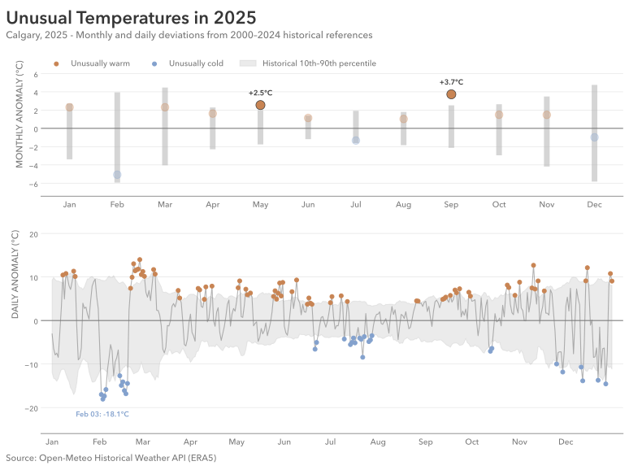
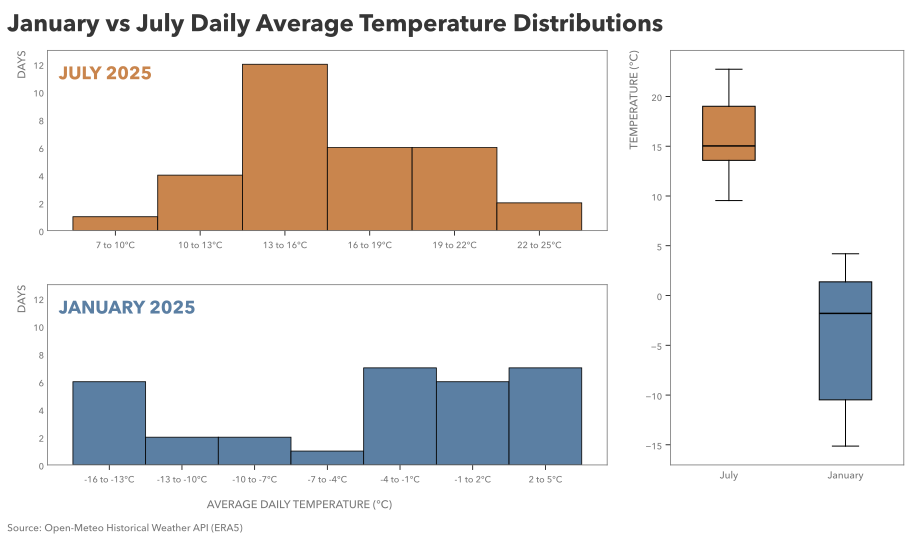
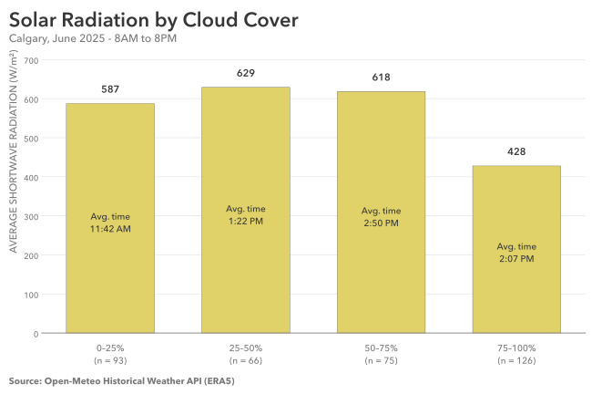
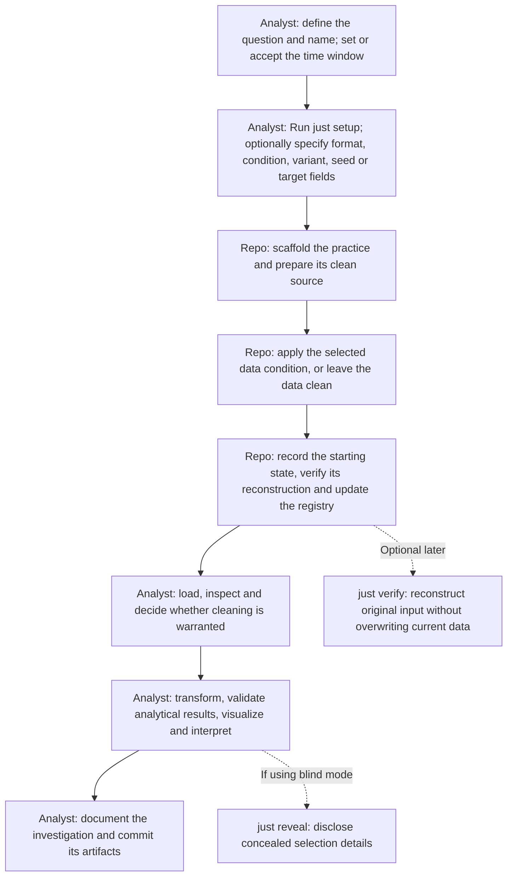

# practice-analysis

A personal analytical-practice system and a growing collection of investigations currently using reproducible Calgary weather data.

This repo prepares varied starting datasets across CSV, JSON, Parquet, and PostgreSQL, including seeded data-quality problems. 

**Explore:** [Selected investigations](#selected-investigations) • [How practice-analysis works](#how-practice-analysis-works) • [Capabilities](#current-capabilities) • [Getting started](#getting-started) • [Practice archive](#practice-archive) • [Technical reference](#technical-reference)

## Selected investigations

These are examples of the analytical work produced *using* AWF's practice approach; the figures were authored during the investigations, not generated automatically by the tooling. Each links to the corresponding investigation README, notebook, and methodology.

### [Historical Temperature Anomalies, 2025](2026-10-28_historical-temp-anomalies/README.md) · Practice 16

[](2026-10-28_historical-temp-anomalies/README.md)

A comparison of 2025 temperature anomalies with 2000–2024 historical references, using monthly percentile intervals and daily deviations. The investigation also handles deliberately invalid source temperatures. [Read the investigation](2026-10-28_historical-temp-anomalies/README.md).

| [January vs July temperature distributions](2026-10-13_jan-vs-july-avg-temp-distribution/README.md) · Practice 11 | [Solar radiation by cloud-cover band](2026-10-30_solar-radation-by-cloud-cover-band/README.md) · Practice 18 |
| :--- | :--- |
| [](2026-10-13_jan-vs-july-avg-temp-distribution/README.md) | [](2026-10-30_solar-radation-by-cloud-cover-band/README.md) |
| Separate histograms preserve each month's distributional shape; a shared-scale boxplot supports comparison. **Parquet.** | A binned descriptive comparison, with observation counts and timing context to help interpret differences. **CSV.** |

**Another selected comparison:** [Monthly Precipitation, 2024 vs 2025 · Practice 8](2026-10-07_monthly-precipitation/README.md) ([view figure](2026-10-07_monthly-precipitation/outputs/monthly-total-precipitation-comparison-2024-vs-2025.svg)). It illustrates grouped aggregation, reshaping, and year-over-year comparison using PostgreSQL.


## How practice-analysis works




A generated practice is an independent `uv` project with its own environment definition, notebook, preparation scripts, public metadata, and `data/` and `outputs/` working directories. The root `justfile` provides a consistent command interface; `tooling/` contains the installable `awf-tooling` package.

`just verify N` verifies the original generated starting state.

## Current capabilities

| Area | Implemented behavior |
|---|---|
| Data interfaces | CSV, JSON, Parquet, or PostgreSQL (with a locally configured database). New exercises use hourly time plus ten weather measurements. |
| Exercise variation | An explicitly chosen or seeded-random format and data condition (including clean data), with supported defect subtypes and field targeting. |
| Practice workspaces | Numbered directories with an independent uv environment, notebook, preparation scripts, and metadata. |
| Reproducibility	| Local source snapshots and selection records, and optional blind conditions. |
| Practice catalog | An index of historical and linked practices, with CLI commands to browse and inspect entries. |

New practices now include `precipitation`, `snowfall`, `dew_point_2m`, and `surface_pressure` alongside the six existing measurements. The [variable and data-condition reference](docs/weather-variable-conditions.md) explains their units, training anomaly ranges, compatible defect types, and limitations. Earlier practices retain their recorded source layout. This is a personal, evolving practice system, not a hosted service or a generally validated cross-platform application.

## Getting started

Requirements: **Python 3.11+**, [`uv`](https://docs.astral.sh/uv/), and [`just`](https://just.systems/). PostgreSQL is optional unless you want SQL exercises. The root of this repository is not itself a Python project.

From the repository root:

```sh
uv sync --locked --no-editable --project tooling
just doctor
just list
```

Create an ordinary CSV exercise with clean data:

```sh
just setup sample-weather --format csv --dirty none \
  --start 2025-01-01 --end 2026-01-01
```

Setup creates a dated practice directory. Open its `analysis.ipynb` to perform the analysis; the notebook's sections are a starting structure, not a worked solution. Setup may need to retrieve historical weather data from Open-Meteo. The configured interval uses Calgary-local calendar dates, with an inclusive start and exclusive end.

For randomized, concealed starting conditions instead:

```sh
just setup another-exercise --blind
```

The [technical reference](#technical-reference) covers safe regeneration, verification, SQL configuration, and the exact meaning of `--blind`.

## Practice archive

The repository contains 19 completed analytical investigations as of November 2026. Each directory has its own README, analytical notebook, and outputs. 

| # | Investigation | Interface |
|---|---|---|
| 1 | [Average June Temperature, 2024–2026](2026-09-02_avg-june-temp/README.md) | CSV |
| 2 | [Average May Temperature, 2024–2026](2026-09-03_avg-may-temp/README.md) | CSV |
| 3 | [Maximum April Temperature, 2024–2026](2026-09-04_max-april-temp/README.md) | CSV |
| 4 | [7-Day Rolling Average Temperature, Final 90 Days](2026-09-08_rolling-avg-temp/README.md) | CSV |
| 5 | [Average Relative Humidity by Hour of Day, August 2025](2026-09-08_avg-hourly-august-humidity/README.md) | CSV |
| 6 | [Average Daily Temperature Range by Month, 2025](2026-09-21_to_2026-09-22_avg-daily-temp-range-per-month/README.md) | CSV |
| 7 | [Daytime vs Overnight Temperature by Month, Summer 2025](2026-10-03_daytime-vs-overnight-temp-by-month/README.md) | CSV |
| 8 | [Monthly Precipitation, 2024 vs 2025](2026-10-07_monthly-precipitation/README.md) | SQL |
| 9 | [Precipitation Days by Month, 2025](2026-10-07_precipitation-days-by-month/README.md) | SQL |
| 10 | [Largest Daily Temperature Swings, 2025](2026-10-13_largest-daily-temp-swings/README.md) | JSON |
| 11 | [January vs July Temperature Distribution, 2025](2026-10-13_jan-vs-july-avg-temp-distribution/README.md) | Parquet |
| 12 | [Trailing 7-Day Precipitation Total, Spring–Summer 2026](2026-10-15_weekly-rolling-precipitation-total/README.md) | CSV |
| 13 | [Cumulative Precipitation, 2024 vs 2025](2026-10-15_yearly-cumulative-precipitation-comparison/README.md) | SQL |
| 14 | [Temperature vs Relative Humidity, August 2026](2026-10-26_temperature-vs-relative-humidity/README.md) | CSV |
| 15 | [Hot and Dry Daytime Hours, Summer 2026](2026-10-27_hot-dry-daytime-hours/README.md) | Parquet |
| 16 | [Historical Temperature Anomalies, 2025](2026-10-28_historical-temp-anomalies/README.md) | JSON |
| 17 | [Longest Freezing Streak, Winter 2025](2026-10-29_longest_freezing_streak/README.md) | SQL |
| 18 | [Solar Radiation by Cloud-Cover Band, June 2025](2026-10-30_solar-radation-by-cloud-cover-band/README.md) | CSV |
| 19 | [Wind Speed by Direction, 2025](2026-11-03_wind-speed-by-direction-2025/README.md) | JSON |

## Technical reference

### Generating, browsing, and verifying

```sh
just setup exercise-slug --blind
just list --linked
just show 19
just verify 19
just reveal 19
```

`--blind` hides the resolved condition, subtype, and seed from normal public metadata; the local `.awf/` record can still be deliberately inspected. Blindness prevents accidental disclosure, not intentional access to private files.

By default, format, corruption family (including clean), applicable subtype, and seed are randomly selected. The exercise question is written by the analyst; it is not generated or randomized. Dates are configured separately. The current source default is all of 2025 in `America/Edmonton` local time. Override when appropriate:

```sh
just setup another-period --blind --start 2024-01-01 --end 2026-01-01
just setup explicit-csv --format csv --dirty missing_values --blind
```

`tooling/selection.toml` records the training probabilities, not real-world prevalence. With all formats eligible: 25% per format, approximately 31.5% clean overall, with the rest spread approximately evenly among supported conditions. If SQL is unavailable, the other formats are renormalized. JSON structural corruption is not implemented and is not randomly selected.

For file-based exercises, `prepare_data.py` and `dirty_data.py` reconstruct from the local frozen clean snapshot, subject to no-overwrite checks. In SQL, `prepare_data.py` refuses to replace an existing practice schema. Use the notebook's Imports, Load, Inspect, Clean, Transform, and Visualize sections to perform the analysis yourself. Open Jupyter using your local workflow or from the practice directory after `uv sync` (for example, `uv run --with jupyter jupyter lab`).

`just verify N` reconstructs the original generated starting state without overwriting the current data. `just reveal N` discloses the hidden condition; `just reveal N --publish` also makes it public. `just index` regenerates the root registry after manual metadata changes. Historical Practices 1–18 are metadata-only registry entries and cannot use the new frozen verification contract.

Generated datasets, private `.awf` records, and clean-source snapshots are Git-ignored. A fresh clone cannot necessarily verify or byte-for-byte reconstruct an older generated practice without those preserved local artifacts. Retain local snapshots if long-term reproduction matters.

### Feature-aware corruption targets

```sh
just setup wind-comparison --blind \
  --dirty-vars wind_speed_10m,wind_direction_10m
```

The comma-separated values form an **OR** pool: the repo chooses one compatible measurement using a deterministic seed. They do not request two simultaneous corruptions. Without the flag, the original V2.1 targeting remains unchanged. Whole-record conditions (`missing_records`, exact duplicates) act on records, not one chosen field; clean is still selectable under the normal probabilities. All ten numeric weather measurements are eligible as **explicit** targets, including `precipitation`, `snowfall`, `dew_point_2m`, and `surface_pressure`. Their generated invalid-value thresholds and corruption compatibility are documented in the [variable and data-condition reference](docs/weather-variable-conditions.md); these are training parameters, not universal physical limits. The resolved target is private until `just reveal N` when using `--blind`. The new-practice default is eleven columns; `--dirty-vars` does not add or remove source fields. Without `--dirty-vars`, the older default field targeting is unchanged.

The default source fields are `time`, `wind_speed_10m`, `wind_direction_10m`, `temperature_2m`, `cloud_cover`, `relative_humidity_2m`, `shortwave_radiation`, `precipitation`, `snowfall`, `dew_point_2m`, and `surface_pressure`. Existing practice manifests pin their original column lists for reconstruction. Future precipitation-composition, snow-event, moisture, and pressure-pattern exercises can use the expanded set.

### Optional PostgreSQL setup and safety

The historical source is the existing `analytical_workflow_fluency` database, `canonical.weather_hourly` table. Use the pre-existing restricted `awf_practice` role; it may read canonical data and create independent practice schemas, but cannot change the canonical table.

```sh
export AWF_DATABASE_URL='dbname=analytical_workflow_fluency user=awf_practice host=/tmp'
unset AWF_CANONICAL_DATABASE_URL
just doctor
```

Keep the canonical-maintenance connection unset during normal practice. Do not run `just sql-sync` against the historical source as part of routine setup; the source is already populated. New SQL practices require the four additional fields to exist in `canonical.weather_hourly`. The generator checks for them and excludes SQL from random selection if the table lacks any; it **never** modifies the protected canonical schema. An explicit SQL request with missing columns will be rejected. Generated SQL data live in a new `practice_NNN.weather_hourly` schema. SQL setup refuses to overwrite an existing practice schema. `just verify` uses isolated reconstruction and does not reset analyst tables.

### Testing and development

After modifying `tooling/src/awf/`, rebuild the non-editable package before running tests, so Python executes updated code rather than a stale installed copy:

```sh
just test-tooling
```

The committed tests use isolated temporary directories and do not require live Open-Meteo requests, PostgreSQL access, or private practice records. They cover the core contracts and offline variable/condition tests, but remain a bounded regression baseline rather than the full historical acceptance suite.

The GitHub Actions workflow in [`.github/workflows/ci.yml`](.github/workflows/ci.yml) runs on pull requests to `main`, pushes to `main`, and manual dispatch. On Ubuntu/Python 3.11 it installs the locked non-editable tooling package, runs offline regression tests, builds a wheel, and smoke-tests that wheel outside the source checkout. The regression suite also checks that committed `practices.toml` matches its source manifests.

CI does not run existing analysis notebooks, contact Open-Meteo, connect to PostgreSQL, or establish native Windows compatibility. Passing CI establishes only the tested contracts, not complete historical-practice reproduction or full cross-platform support.

## Data, attribution, and license

Weather observations originate from the [Open-Meteo Historical Weather API](https://open-meteo.com/) / ERA5 and are interpreted using Calgary local time (`America/Edmonton`). The code is licensed under [Apache License 2.0](LICENSE); data retain their respective attribution and licensing requirements. Individual investigations include more detailed source attribution.
